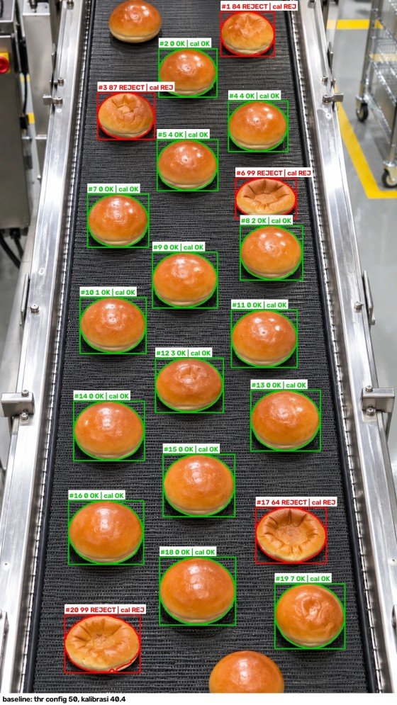
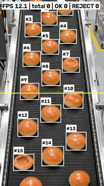
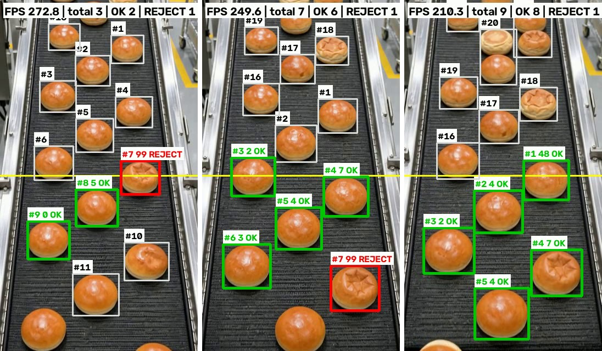
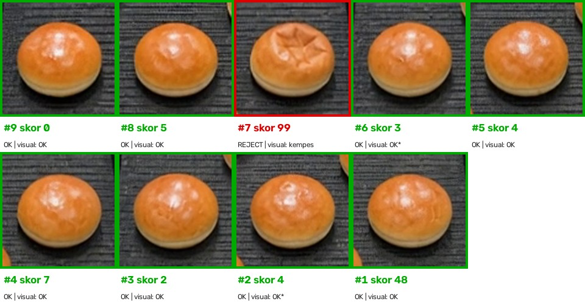
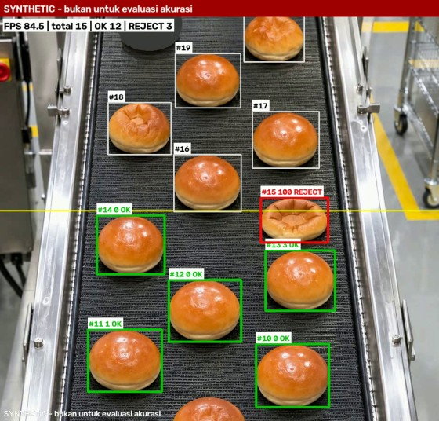
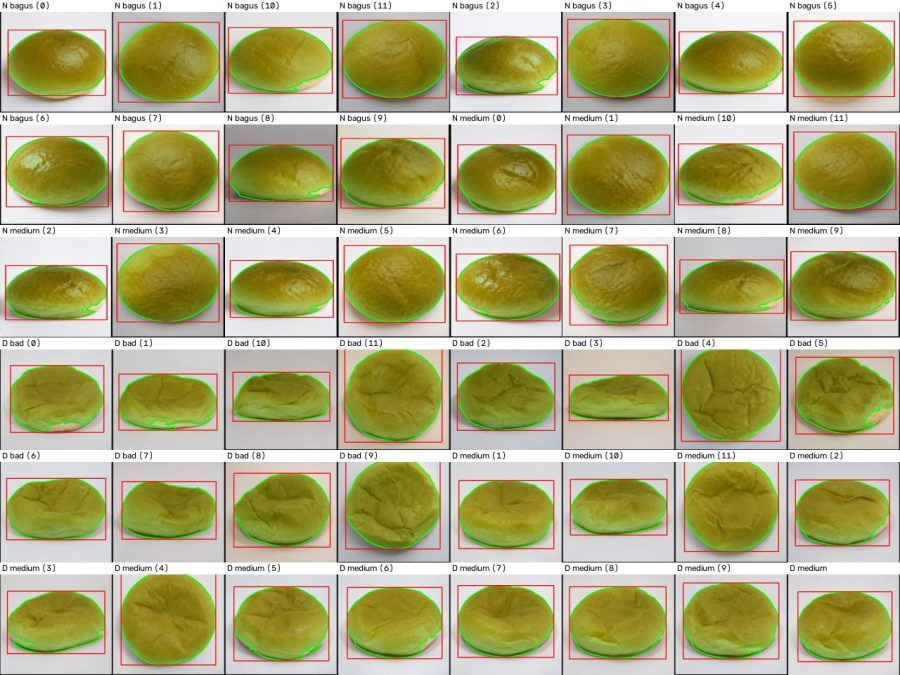

# LoafLens

**Deteksi roti kempes (afkir) di konveyor dengan kamera biasa dan model ML lokal: low-cost, CPU-only, tanpa layanan cloud.**

LoafLens adalah proof-of-concept (POC) inspeksi visual untuk lini produksi roti:

- Setiap roti yang lewat di konveyor disegmentasi dari gambar kamera, lalu diikuti antar frame.
- Saat roti melintasi garis keputusan, roti diberi **skor kempes 0–100**.
- Roti dengan skor ≥ `threshold` (di config) ditandai **REJECT**.
- Semua inferensi berjalan di CPU laptop atau mini PC, tanpa GPU, LLM, maupun API eksternal.

<p align="center">
  
  <br><em>Foto konveyor asli (941×1672): 5/5 roti kempes REJECT (merah), 15/15 roti OK lolos (hijau).</em>
</p>

> **Status: POC, M0–M4 selesai.** Semua angka di bawah adalah **indikasi kelayakan**, bukan akurasi
> produksi. Model dilatih dari 48 foto studio. Keterbatasannya dijelaskan terbuka di bagian
> [Keterbatasan](#keterbatasan).
>
> Panduan lengkap (instalasi, config, alur kerja, troubleshooting): **[`docs/USAGE.md`](docs/USAGE.md)**

---

## Daftar isi
- [Cara kerja](#cara-kerja)
- [Bukti hasil](#bukti-hasil)
- [Keterbatasan](#keterbatasan)
- [Quickstart](#quickstart)
- [Dokumentasi](#dokumentasi)

## Cara kerja

```
kamera / file video
      │
      ▼
segmentasi ──► tracking ──► garis keputusan ──► scorer ──► OK / REJECT
(roti vs latar)  (ID per roti)  (1 roti = 1 keputusan)  (skor 0–100)  (+ snapshot & log CSV)
```

| Komponen | Implementasi |
|---|---|
| Segmentasi | OpenCV: saturasi HSV + Otsu, kontur per roti, ROI opsional, roti di tepi frame diabaikan |
| Tracking | centroid tracker; tiap roti diputuskan **tepat sekali** saat melintasi garis |
| **Scorer A, baseline (dipakai)** | 25 fitur tekstur, kilap, warna, dan bentuk dari crop kanonik 64 px → logistic regression (scikit-learn), dilatih dengan augmentasi resolusi (roti 50–200 px + JPEG); skor = 100 × P(kempes); sekitar 2–10 ms/roti, model 3 kB |
| Scorer B, anomaly (eksperimen) | "PatchCore-lite": ResNet18 beku + memory bank roti normal (PyTorch CPU); butuh refit untuk domain konveyor |
| Output | overlay real-time (kotak, skor, OK/REJECT, FPS, penghitung), snapshot setiap REJECT, `decisions.csv` |

## Bukti hasil

### 1. Foto konveyor asli: roti bagus dan kempes
Satu foto konveyor berisi 20 roti utuh: 5 kempes dan 15 OK, termasuk 2 roti dengan lekukan kecil yang
dikonfirmasi user masih diterima. Model **tidak** dilatih dengan foto ini, dan threshold tidak disetel
darinya.

| | Scorer A |
|---|---|
| Roti kempes REJECT | **5/5** (skor 64–99) |
| Roti OK lolos | **15/15** (skor 0–7) |
| AUROC | 1.00 |

Gambar di bagian atas README adalah hasil ini (model setelah perbaikan resolusi). Detailnya ada di
[`docs/domain_check_mixed.md`](docs/domain_check_mixed.md). Pada foto konveyor kedua yang berisi 15 roti
bagus, scorer A me-reject 0 roti (skor 0–15). Catatan: kedua foto ini ikut dipakai sebagai data
validasi saat memilih perbaikan resolusi, jadi bukan uji independen lagi.

### 2. Video konveyor 10 detik
Video dari user: 360×640 px, 24 fps, lebar roti hanya sekitar 55–75 px. Video ini data uji hold-out:
tidak dipakai untuk memilih metode atau threshold. Gambar di bawah dari **Run 2** (setelah perbaikan
resolusi), threshold config 50.

<p align="center">
  
  &nbsp;
  
</p>

Keputusan untuk setiap roti yang melintasi garis, dengan crop diambil pada frame keputusan:

<p align="center">
  
</p>

| | Run 1 (model lama) | **Run 2 (setelah perbaikan)** |
|---|---|---|
| Roti diputuskan / duplikat | 9 / 0 | 9 / 0 (tracking benar) |
| Roti kempes REJECT | 1/1 (skor 100) | **1/1** (skor 99) |
| Roti OK ikut ter-reject | **7/8**, gagal | **0/8** (skor 0–7, kecuali satu roti 48) |

**Run 1 gagal, dan dilaporkan apa adanya.** Penyebabnya diuji dan terbukti **resolusi**: foto
konveyor yang diperkecil ke skala video langsung naik salah tolaknya dari 0/15 menjadi 8/15 dan 5/15.
Fitur tekstur/kilap dihitung dari crop 192 px, sehingga roti kecil yang diperbesar tampak "kempes".

**Perbaikan:** fitur kini dihitung dari crop kanonik kecil (64 px, parameter piksel diskalakan 1/3),
dan classifier dilatih dengan salinan foto yang diperkecil ke roti 50–200 px + kompresi JPEG.
Metode dipilih hanya dari CV studio dan dua foto konveyor yang diperkecil (tanpa video). Di validasi itu
salah tolak pada skala video turun dari 8/15 dan 5/15 menjadi 0/15 dan 0/15, kempes tetap 5/5.
Setelah metode dibekukan, video dijalankan **sekali**: hasilnya Run 2 di atas.

Caveat: n kecil (9 roti, 1 kempes); satu roti OK mendapat skor 47.7, hanya sedikit di bawah threshold 50
(akan REJECT pada saran kalibrasi 40.4). Di frame ketiga, roti #4 (OK, skor 7) tampak berlekuk
bintang **setelah** melewati garis. Di frame keputusan (frame 150) permukaannya masih mulus, jadi
bentuknya berubah di dalam video itu sendiri. Keputusan diambil sekali saat melintas, sesuai desain.
Analisis lengkap, tabel validasi per skala, dan caveat ada di
[`docs/results_real_video.md`](docs/results_real_video.md).

### 3. Uji pipeline real-time (video SYNTHETIC)
Video demo dibuat dengan menggeser dua foto konveyor, menghasilkan 70 roti dengan posisi yang
diketahui. Uji ini membuktikan logika pipeline (tracking dan penghitungan), **bukan** akurasi deteksi.

<p align="center">
  
</p>

| Diharapkan / diputuskan | Duplikat / terlewat | Miscount | Kempes REJECT | OK ter-reject | Kecepatan |
|---|---|---|---|---|---|
| 70 / 70 | 0 / 0 | **0%** | 10/10 | 0/60 | sekitar 90 FPS (CPU 4 core) |

Detail: [`docs/results_m4.md`](docs/results_m4.md).

### 4. Dataset studio (48 foto)
Data latih: 24 roti OK dan 24 roti kempes, satu roti per foto. Split dibekukan, dan threshold tidak
pernah disetel dari test set.

<p align="center">
  
</p>

| | Scorer A | Scorer B |
|---|---|---|
| AUROC cross-validation (train+val) | 1.000 (model lama 0.988 ± 0.025) | 1.000 |
| Test (4+4 foto) | 8/8 benar | 8/8 benar |
| Foto konveyor: roti OK ter-reject | **0/15** | 15/15 (gagal, beda domain) |
| Threshold terkalibrasi (CV, FPR ≤ 0.05) | 40.4 (config tetap 50) | 52.1 |

Detail: [`docs/results_m3.md`](docs/results_m3.md).

## Keterbatasan
- **Data latih kecil dan berbeda domain.** Model dilatih dari 48 foto studio, belum dari kamera
  konveyor.
- **Resolusi masih punya batas bawah.** Setelah perbaikan, scorer A lolos validasi sampai lebar roti
  sekitar 50–60 px dan lolos video 360p (roti 55–75 px). Di bawah sekitar 55 px salah tolak muncul
  lagi, dan bukti video baru satu klip pendek (9 roti, 1 kempes).
- **Scorer A banyak memakai kilap dan warna**, bukan hanya kerutan. Variasi pencahayaan bisa
  memengaruhi skor.
- **Scorer B** baru layak setelah memory bank-nya diisi ulang dari roti bagus di kamera konveyor.
- **Langkah berikutnya:**
  - kumpulkan foto atau video roti OK dan kempes dari kamera produksi (lebar roti sebaiknya ≥ 80 px);
  - latih ulang dan kalibrasi threshold di data validasi;
  - uji kamera minimal 5 menit (PRD §9);
  - opsional M5: export ONNX, uji di Raspberry Pi, sinyal keluaran untuk aktuator.

## Quickstart

Butuh [`uv`](https://docs.astral.sh/uv/) dan `make` (Linux, atau macOS Apple Silicon ≥ 14). Python 3.14
diunduh otomatis oleh `uv`.

```bash
git clone https://github.com/ndollem/loaf-lens.git && cd loaf-lens
```

```bash
make setup
```

```bash
make train
```

```bash
make demo-video
```

```bash
make demo-live
```

```bash
make camera
```

- `make setup` membuat `.venv` dan memasang dependency terkunci (PyTorch CPU-only).
- `make train` melatih scorer A dalam sekitar 10 detik. Model tidak di-commit, jadi langkah ini wajib
  setelah clone.
- `make demo-live` menampilkan window demo dengan video SYNTHETIC; tekan `q` atau ESC untuk keluar.
- `make camera` memakai kamera langsung (`CAMERA=1` untuk iPhone atau webcam USB). Izin kamera macOS
  dan tips posisi kamera ada di [`docs/USAGE.md` §6.8](docs/USAGE.md#68-kamera--demo-kamera-ke-layar).

Uji video sendiri, misalnya video konveyor 10 detik di atas:

```bash
.venv/bin/python -m loaflens.app --config configs/baseline.yaml --source video:samples/conveyor_real_10s.mp4 --headless --out outputs/real_out.mp4
```

Evaluasi, kalibrasi, scorer B, dan semua target Makefile ada di [`docs/USAGE.md`](docs/USAGE.md).
Repo ini tidak cocok dideploy ke Vercel atau serverless, karena butuh kamera lokal dan proses yang
terus berjalan.

## Dokumentasi
| Dokumen | Isi |
|---|---|
| [`docs/USAGE.md`](docs/USAGE.md) | panduan lengkap: instalasi, data, config, alur kerja, output, CLI, troubleshooting |
| [`docs/PRD.md`](docs/PRD.md) | tujuan, requirement, acceptance criteria, status milestone |
| [`docs/results_real_video.md`](docs/results_real_video.md) | uji video konveyor 10 detik: Run 1 gagal, diagnosis resolusi, perbaikan + Run 2 |
| [`docs/domain_check_mixed.md`](docs/domain_check_mixed.md) | uji foto konveyor campuran (bagus + kempes) |
| [`docs/results_m3.md`](docs/results_m3.md) | perbandingan scorer A vs B, kalibrasi threshold |
| [`docs/results_m4.md`](docs/results_m4.md) | uji pipeline real-time (video SYNTHETIC) |
| [`data/README.md`](data/README.md) | aturan data, cara menambah foto |
| [`CLAUDE.md`](CLAUDE.md) | aturan kerja dan konvensi kode |

**Data:** foto latih di `train-data/` sengaja di-commit atas keputusan user. Video, model, dan
`outputs/` tidak masuk git.
